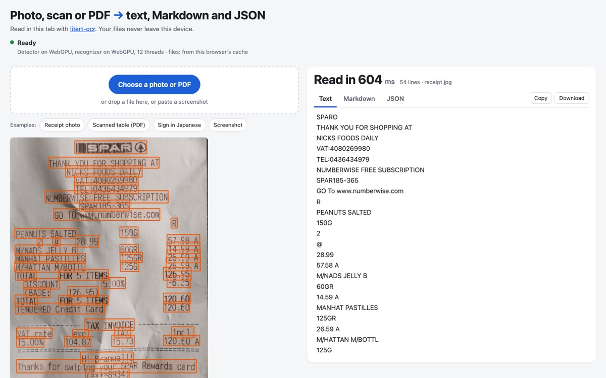

# litert-ocr

OCR for photos and screenshots in the browser and in Node.js, with the tesseract.js API. It runs PP-OCRv6-Small on LiteRT.js. On 2026-11-10, version 0.2.1 read an image in 2,982 ms on a Pixel 8a in Chrome 156, with the model already loaded. Images never leave the device.

<p align="center"></p>

[Try the demo](https://mlboydaisuke-litert-ocr.static.hf.space/) on your own photo, scan or PDF. It reads the file in the browser tab, draws a box around each line of text, and gives you the text, Markdown and JSON.

## Install

```sh
npm install litert-ocr
```

```js
import { createWorker } from 'litert-ocr';

const worker = await createWorker('eng');
const { data } = await worker.recognize('https://example.com/receipt.jpg');
console.log(data.text);
await worker.terminate();
```

From a CDN, with no build step:

```html
<script type="module">
  import { createWorker } from 'https://cdn.jsdelivr.net/npm/litert-ocr@0.2.2/+esm';
</script>
```

One model reads Latin-script, Greek, Chinese and Japanese text, so `'eng'` reads them all. Korean, Cyrillic, Arabic, Hebrew, Thai and Indic scripts are not covered: `createWorker('kor')` rejects.

The first run downloads about 34 MB of model files and caches them.

In a browser, WebAssembly needs [two headers](docs/speed-and-files.md#cross-origin-headers) to use more than one thread.

## Switching from tesseract.js

Change the import:

```diff
- import { createWorker } from 'tesseract.js';
+ import { createWorker } from 'litert-ocr';
```

The calls and the result shape stay the same. A few options and output formats [differ](docs/switching-from-tesseract.md). Each detected line comes back on its own, so a table row can come out as separate lines. For tables, use `convert`.

## PDFs, JSON and agents

Turn a PDF or a scan into Markdown with tables, JSON or text ([Documents → Markdown](docs/documents.md#documents--markdown)):

```js
import { convert } from 'litert-ocr';

const { content, document } = await convert(file, { to: 'md' });
```

From the [command line](docs/documents.md#cli):

```sh
npx litert-ocr report.pdf > report.md
```

As an [MCP server](docs/documents.md#mcp) for coding agents:

```sh
claude mcp add litert-ocr -- npx -y litert-ocr mcp
```

[`extract`](docs/documents.md#extract-json) fills a JSON Schema from a document with an on-device language model. It needs a browser with WebGPU, and its first call downloads 2.0 GB.

## Speed and accuracy

Time per image with the model already loaded (litert-ocr 0.2.1, 2026-11-10):

| Browser | Images | Time per image |
|---|---|---|
| Chrome 157, Mac Studio with Apple M4 Max | 281 | 173 ms |
| WebKit 26.5, Playwright's build of Safari's engine, same Mac | 12 | 291 ms |
| Chrome 156, Galaxy S26, CPU clock capped | 12 | 766 ms |
| Chrome 156, Pixel 8a | 12 | 2,982 ms |

The receipt in the picture is a long one: 54 lines in 604 ms on the same Mac.

Character error rate on 2026-10-19 is lowest on screenshots: 0.6 % in English and 1.4 % in Japanese. It rises to 10 % on receipts from the CORD set, 26.7 % on English photos from the TextOCR set and 30.5 % on Japanese photos of signs from the JaWildText set. [All the numbers and how they were measured](docs/speed-and-files.md#speed-and-accuracy).

Status: v0. Tested in Node.js 24, Deno 2.9 and Bun 1.4, in Chrome, and in Playwright's WebKit build. Safari itself (on a Mac or an iPhone) and Firefox are not tested yet.

## Reference

- [API](docs/api.md#api)
- [Errors](docs/api.md#errors)
- [Offline](docs/speed-and-files.md#offline)
- [Model and runtime files](docs/speed-and-files.md#model-and-runtime-files)
- [Safari and WebGPU](docs/speed-and-files.md#safari-and-webgpu)
- [Tests](docs/tests.md)

## Examples

- [`examples/html`](examples/html): plain HTML with the CDN import (`node serve.mjs` serves it with the two headers).
- [`examples/react-vite`](examples/react-vite): React with Vite.
- [`examples/nextjs`](examples/nextjs): Next.js App Router, with the import inside `useEffect` of a client component.
- [`examples/pdf-to-markdown`](examples/pdf-to-markdown): documents to Markdown, JSON or text, in the browser and in Node.js.
- [`examples/mcp`](examples/mcp): the MCP server's configuration for Claude Code and Claude Desktop.

## License

Apache License 2.0. See [NOTICE](NOTICE) for the parts copied from google-ai-edge/litert-samples and for the model and runtime licenses. Independent project, not affiliated with Google or PaddlePaddle.
